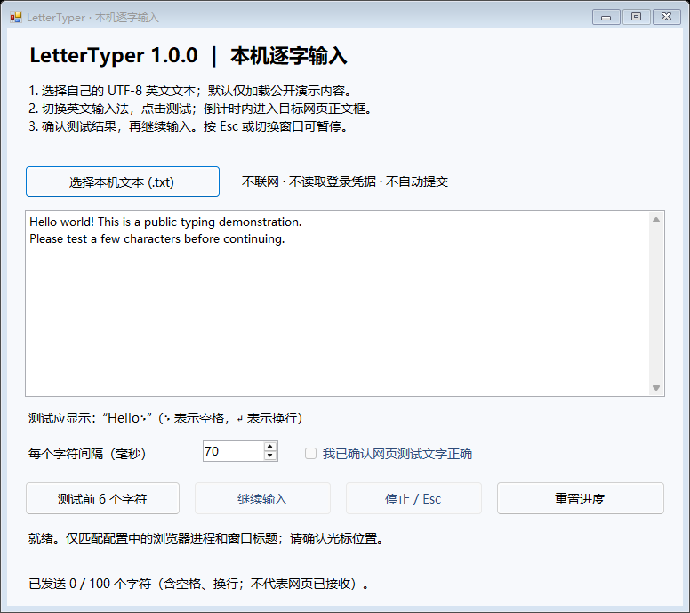

# LetterTyper · 本机逐字输入工具

LetterTyper 是 Windows 桌面上的英文文本逐字录入工具。使用者选择自己的 UTF-8 文本文件，在倒计时内点击网页的**多行正文输入框**，工具通过系统键盘事件逐个发送字符。适合允许自动录入、但普通粘贴不能工作的编辑页面。

默认匹配标题包含“批改”或 `pigai` 的浏览器窗口，可用于尝试批改网的作文正文编辑页面。**窗口匹配不代表验证了网址；本版本尚未在真实登录网页完成端到端验证，必须先测试少量字符。** 本项目与批改网无隶属关系。

## 功能

- 从本机选择 `.txt` 文件；默认内容只有公开示例，不含任何作文或学生信息。
- 先发送少量测试字符，人工确认后再继续，避免一开始发送全文。
- 默认 8 秒倒计时，字符间隔 70 毫秒；间隔可在界面调整。
- 按 Esc、点击停止、切换前台窗口或发生窗口标题变化时暂停。
- 暂停后从内存中的进度继续；重置、重新加载文件或关闭程序会重置进度。
- 不联网、不使用剪贴板、不读取密码/Cookie/Token，不自动点击提交。

## 真实截图



截图来自本项目实际运行的 Windows Forms 窗口，通过控件的 `DrawToBitmap` 保存，内容仅为 `examples/sample.txt`；没有使用网站账号页面、学生信息或私人作文截图。

## 安装与启动

下载：[便携运行包](https://github.com/s13753540656-sys/letter-typer/raw/refs/heads/main/downloads/LetterTyper-1.0.0-portable.zip) · [完整源码包](https://github.com/s13753540656-sys/letter-typer/raw/refs/heads/main/downloads/LetterTyper-1.0.0-source.zip) · [SHA-256 校验文件](https://github.com/s13753540656-sys/letter-typer/blob/main/downloads/SHA256SUMS.txt)

1. 下载 `LetterTyper-1.0.0-portable.zip`，**完整解压**到一个普通目录。不要在 ZIP 预览中直接运行。
2. 使用 Windows 10/11 交互桌面，确保 Windows PowerShell 5.1 和 .NET Framework 4.8 可用。
3. 双击 `start.cmd`。它使用系统自带 PowerShell 在本机编译随包 C# 源码，然后打开界面。首次启动可能需要几秒。

无需 Python、Node.js、Visual Studio、浏览器插件、账号连接或管理员权限。运行包包含 C# 源码，**并非不依赖系统环境的单个 EXE**。源码包也可按同样方式启动，额外包含打包和验证脚本。

若组织策略限制 PowerShell、动态编译或模拟按键，请联系管理员；启动器不会修改执行策略或应用控制设置。`.NET Framework` 缺失时，请使用 [Microsoft 官方安装说明](https://learn.microsoft.com/en-us/dotnet/framework/install/guide-for-developers)。

## 使用步骤

1. 准备 UTF-8 英文 `.txt`，点击“选择本机文本”。可把自己的文件放在被 Git 忽略的 `data/` 中。
2. 打开允许录入的目标页面，登录操作由你自行完成；切换为英文输入法。
3. 点击“测试前 6 个字符”，倒计时内点击网页的多行正文框。查看工具显示的预期文字，`␠` 表示空格，`↵` 表示换行。
4. 确认网页文字正确后，返回工具，勾选测试确认，再点“继续输入”；倒计时内把光标放到刚才文字的末尾。
5. 输入期间保持目标窗口、标签页和光标位置不变。需要停止时按住 Esc，或切回工具。
6. 完成后自行核对文字、标点和分段，再决定是否提交。

工具不会清空正文。覆盖原有内容前，请先自行备份和清空；重置工具的进度不会删除网页文字。详见[独立使用教程](docs/USAGE.md)。

## 适用页面与权限

默认支持进程名为 `msedge`、`chrome`、`firefox`、`brave`、`opera`、`vivaldi`，且窗口标题含“批改”或 `pigai` 的前台窗口。这是**匹配名单，不是浏览器兼容性测试结果**。仅建议用于普通多行文本框；富文本、iframe、远程桌面等需单独测试。

程序需要读取所选文本、可选本地配置、当前窗口标题和进程名，检查 Esc/修饰键状态，并向当前活动窗口发送键盘事件。正常运行不需要管理员权限，也不需要账号、Cookie 或 Token。程序不读取浏览器配置或登录数据；登录后的网页接收到文字后，网页本身的保存机制仍然生效。详见[隐私与权限](docs/PRIVACY.md)。

## 可选配置

无需配置即可使用默认值。若需调整，复制 `config.example.json` 为 `config.local.json`，修改后重启。该文件已被 Git 忽略。

| 字段 | 默认值 | 允许范围或含义 |
| --- | --- | --- |
| `countdownSeconds` | 8 | 3–60 秒 |
| `intervalMs` | 70 | 30–500 毫秒，非精准定时保证 |
| `testCharacters` | 6 | 1–20 个字符 |
| `titleKeywords` | 批改、pigai | 标题包含任一关键词，不支持通配符 |
| `browserProcesses` | 六种浏览器进程名 | 不含 `.exe`，忽略大小写 |

配置中不要写账号、密码、真实网址中的身份信息或凭据。若调整匹配规则到其他页面，须自行验证，程序无法确认真实域名或输入框。

## 目录结构

```text
LetterTyper/
├─ LetterTyper.cs             # 界面、输入会话、窗口检查和自检
├─ start.cmd                  # 双击启动
├─ verify.cmd                 # 无键盘事件的自动检查
├─ package.cmd                # 源码包中提供：创建发布 ZIP
├─ config.example.json        # 不含凭据的示例配置
├─ examples/sample.txt        # 公开演示内容
├─ docs/
│  ├─ USAGE.md                # 详细教程和常见问题
│  ├─ PRIVACY.md              # 数据与权限
│  ├─ VALIDATION.md           # 实际验证结果和边界
│  ├─ GITHUB.md               # 源码包中提供：上传说明
│  └─ images/window.png       # 实际运行截图
├─ scripts/                   # 源码包中提供：打包、截图、按键测试
├─ tests/                     # 源码包中提供：隔离按键测试窗口
├─ DEPENDENCIES.md
├─ THIRD_PARTY_NOTICES.md
├─ LICENSE
└─ VERSION
```

`data/`、`config.local.json`、`dist/`、日志、临时文件和凭据不属于仓库内容。`downloads/` 仅存放核对后的公开发行 ZIP 和校验文件。**不要上传整个上级工作目录或自己的文本文件。**

## 验证与打包

在 Windows 命令提示符中运行 `verify.cmd`，检查字符编码、特殊符号转义、分段、测试/续输边界、失败后的进度和配置范围。该命令不向任何窗口发送键盘事件。

源码目录中运行 `package.cmd`，会按显式文件清单生成 `dist/` 下的源码 ZIP、便携运行 ZIP 和 `SHA256SUMS.txt`，不会复制 `data/` 或本地配置。完整验证状态见 [VALIDATION.md](docs/VALIDATION.md)。

## 已知限制

- 仅支持英文 ASCII（U+0020–U+007E）和换行；不支持中文、弯引号、长破折号、制表符等。换行发送为 Enter，**不要用于按 Enter 会提交的单行表单**。
- 窗口标题检查不能证明真实域名，也不能判断光标位置。同一窗口中切到同标题页面可能无法察觉；检查与发送之间也存在短暂竞态。
- 进度是“已发送字符数”，不代表网页实际接收。缺字、错位或发送异常后，不能仅凭计数确认内容正确。
- 不是物理键盘，不保证网站接收模拟输入，不保证通过反自动化限制，也不会解决验证码。
- Esc 使用状态轮询，快速轻触可能未被捕获；请稍按住，或切换窗口暂停。
- 不保存进度，不自动回读、校对、清空、定位光标或提交；暂停时人工修改正文后可能需要从头重做。
- macOS/Linux、所有浏览器组合、不同键盘布局、高 DPI、受管设备、远程桌面及真实登录网页均未全面验证。

## 许可与来源

项目代码、文档和公开演示内容按 [MIT License](LICENSE) 分发。仅依赖系统自带组件，无额外第三方软件包、模型或素材。Microsoft 系统组件不包含在 ZIP 中，其许可由各自产品条款约束，详见[依赖清单](DEPENDENCIES.md)和[第三方声明](THIRD_PARTY_NOTICES.md)。
